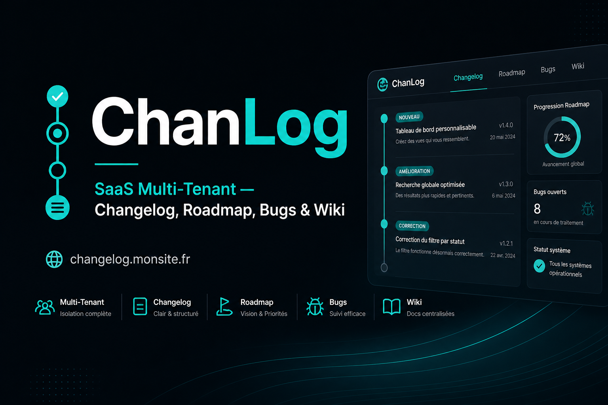
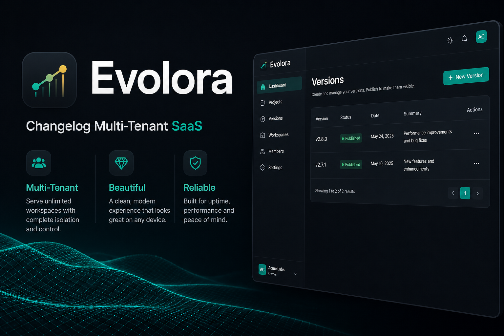
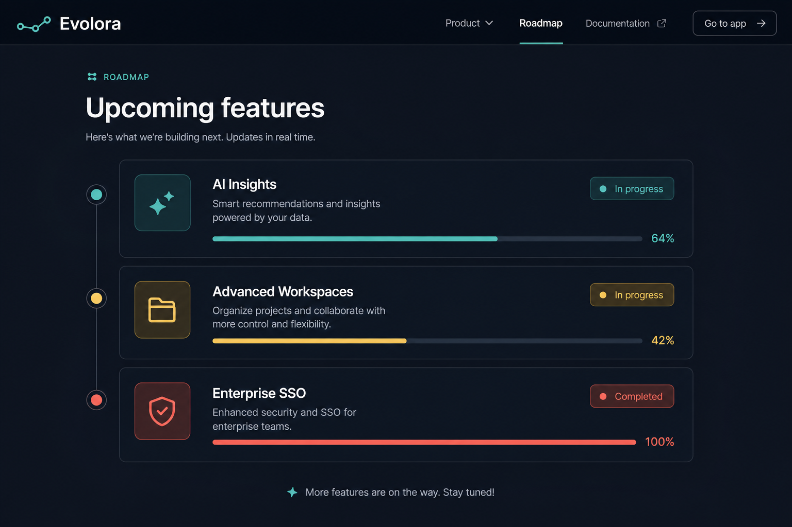
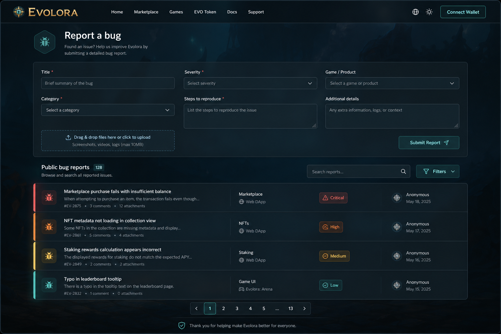
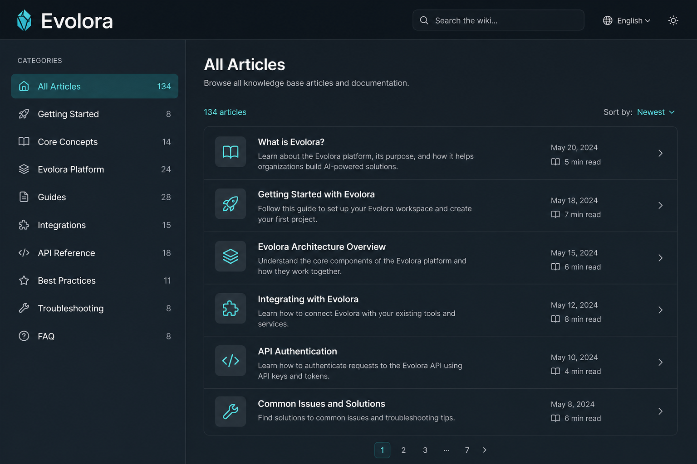
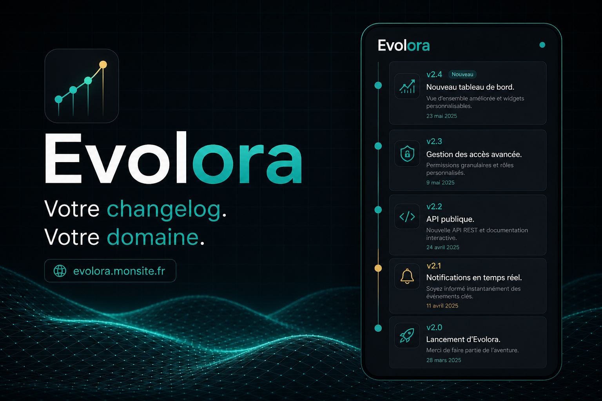

<p align="center">
  
</p>

<p align="center">
  
</p>

# Evolora

<p align="center">
  <strong>SaaS multi-tenant</strong> — Changelog · Roadmap · Bugs · Wiki<br/>
  <code>changelog.monsite.fr</code>
</p>

## À propos d’Evolora

**Evolora** est une application web Laravel pour publier les versions d’un produit : changelog, roadmap, signalement de bugs et wiki, dans un espace public à votre marque.

Chaque compte client peut créer son propre espace sous un sous-domaine (`slug.votredomaine.fr`) ou un domaine personnalisé.

**Identité visuelle :** `logo.png`, `logo.svg`, `icon.svg`, `assets/logo/`, `Promo/`

## Prérequis

- PHP 8.2 ou supérieur
- Composer
- MySQL 5.7 ou supérieur
- Node.js et NPM (pour les assets frontend)

## Installation

1. Clonez le dépôt
   ```
   git clone <url-du-dépôt>
   cd projet_laravel
   ```

2. Installez les dépendances PHP (développement local)
   ```
   composer install
   ```

   En production (`APP_ENV=production`), cette commande est refusée : elle installerait PHPUnit et peut cloner des dépôts Git dans `vendor/`. Utilisez :

   ```
   composer install --no-dev --prefer-dist --optimize-autoloader --no-interaction
   ```

3. Installez les dépendances JavaScript
   ```
   npm install
   npm run dev
   ```

4. Copiez le fichier d'environnement et générez la clé d'application
   ```
   cp .env.example .env
   php artisan key:generate
   ```

5. Configurez la base de données dans le fichier .env

## Configuration de la base de données

Les informations de connexion à la base de données sont configurées dans le fichier `.env` à la racine du projet. Voici les paramètres actuels :

```

DB_CONNECTION=mysql
DB_HOST=127.0.0.1
DB_PORT=3306
DB_DATABASE=laravel
DB_USERNAME=laravel
DB_PASSWORD=Laravel

```

### Explication des paramètres

- **DB_CONNECTION** : Type de base de données (mysql, sqlite, pgsql, sqlsrv)
- **DB_HOST** : Adresse du serveur de base de données (localhost ou 127.0.0.1 pour un serveur local)
- **DB_PORT** : Port de connexion à la base de données (3306 par défaut pour MySQL)
- **DB_DATABASE** : Nom de la base de données
- **DB_USERNAME** : Nom d'utilisateur pour se connecter à la base de données
- **DB_PASSWORD** : Mot de passe pour se connecter à la base de données

## Migration et seeding

Pour créer les tables dans la base de données et les remplir avec des données de test :

```
php artisan migrate
php artisan db:seed
```

## Lancement de l'application

Pour démarrer le serveur de développement :

```
php artisan serve
```

L'application sera accessible à l'adresse http://127.0.0.1:8000

## Fonctionnalités principales

- Changelog public, avec images, et flux RSS fixe : `https://slug.votredomaine.fr/changelog.xml`
- Abonnement e-mail « Prévenez-moi des prochaines versions » (confirmation obligatoire avant tout envoi)
- Suivi d’un bug : « Prévenez-moi quand le statut change », avec la même confirmation
- Votes publics sur la feuille de route (« Je veux ça »), un vote par navigateur
- Widget à coller sur le site du client (liste des versions ou badge Nouveautés)
- Plusieurs personnes sur un projet : l’administrateur invite un éditeur, sans facturation ni domaine
- Suivi des rapports de bugs
- Wiki
- Quatre thèmes publics
- Interface d’administration

## Utilisation

### Flux RSS

L’adresse ne change pas et ne demande pas de compte : `https://slug.votredomaine.fr/changelog.xml`. Les lecteurs RSS et les outils s’y abonnent. Le lien est aussi annoncé dans les pages publiques du projet.

### Abonnements e-mail

Sur le changelog, le visiteur laisse seulement son adresse. Il reçoit un lien de confirmation. Tant que ce lien n’est pas ouvert, aucune version ne lui est envoyée. Le même principe existe sur la fiche d’un bug, pour le changement de statut. Le message affiché est le même que l’adresse existe déjà ou non.

En production, configurez un vrai envoi :

```
MAIL_MAILER=smtp
MAIL_HOST=smtp.exemple.fr
MAIL_PORT=587
MAIL_USERNAME=
MAIL_PASSWORD=
MAIL_FROM_ADDRESS=noreply@votredomaine.fr
MAIL_FROM_NAME=Evolora
```

Avec `MAIL_MAILER=log` (valeur de l’installeur), les messages sont seulement écrits dans `storage/logs`. Le site fonctionne quand même.

### Votes

Chaque idée publique a un bouton « Je veux ça ». Un second clic retire le vote. Le compteur est visible par les visiteurs et dans l’admin. La priorité choisie par l’administrateur reste distincte de ce compteur.

### Widget

Dans l’admin, Changelog affiche les deux extraits à copier. Ils pointent vers le site public du projet, pas vers le domaine central.

Liste des dernières versions :

```html
<script src="https://slug.votredomaine.fr/widget.js" async></script>
```

Badge Nouveautés :

```html
<script src="https://slug.votredomaine.fr/widget.js" data-evolora-badge async></script>
```

Le script n’affiche que le numéro, la date, un court extrait et le lien vers le changelog. Il ne lit pas les cookies du site qui l’héberge.

### Équipe

L’administrateur ouvre **Équipe**, saisit le nom, l’adresse et un mot de passe d’au moins 8 caractères. Le compte créé est un éditeur : changelog, feuille de route, bugs et wiki. La facturation, le domaine et la gestion de l’équipe restent réservés à l’administrateur. Le mot de passe temporaire affiché après une réinitialisation n’est montré qu’une fois.

## Mise à jour depuis une version précédente

```
composer install --no-dev --prefer-dist --optimize-autoloader --no-interaction
php artisan migrate --force
php artisan view:clear
```

La migration ajoute le rôle de projet (`owner` pour les comptes déjà présents), les abonnés, les suivis de bugs et les votes.

## Structure de la base de données

### Table versions
- id
- number (numéro de version)
- release_date (date de sortie)
- description
- changes (modifications apportées)
- image_path (chemin vers l'image associée)
- timestamps (created_at, updated_at)

### Table bug_reports
- id
- title (titre du bug)
- description
- reporter_name (nom du rapporteur)
- reporter_email (email du rapporteur)
- status (statut : new, in_progress, resolved, closed)
- progress (progression en pourcentage)
- color (couleur associée au statut)
- severity (gravité du bug)
- expected_fix_date (date prévue de correction)
- admin_notes (notes de l'administrateur)
- timestamps (created_at, updated_at)

### Table wiki_categories
- id
- name (nom de la catégorie)
- description
- slug (URL conviviale)
- timestamps (created_at, updated_at)

### Table wiki_articles
- id
- category_id (référence à la catégorie)
- title (titre de l'article)
- content (contenu de l'article)
- slug (URL conviviale)
- timestamps (created_at, updated_at)

### Table settings
- id
- key (clé du paramètre)
- value (valeur du paramètre)
- is_active (état d'activation)
- timestamps (created_at, updated_at)


### Screen
# Aperçu du projet

| Cover | Roadmap | Bugs |
|---------|---------|------------|
|  |  |  |

| Wiki | Marque | GitHub |
|---------------------|----------------------|----------------------|
|  |  |  |


## Licence

Ce projet est sous licence [MIT](https://opensource.org/licenses/MIT).
